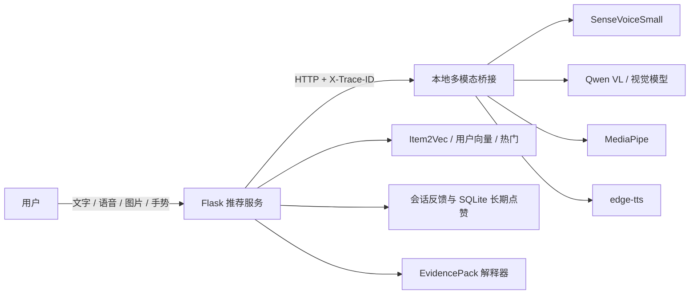
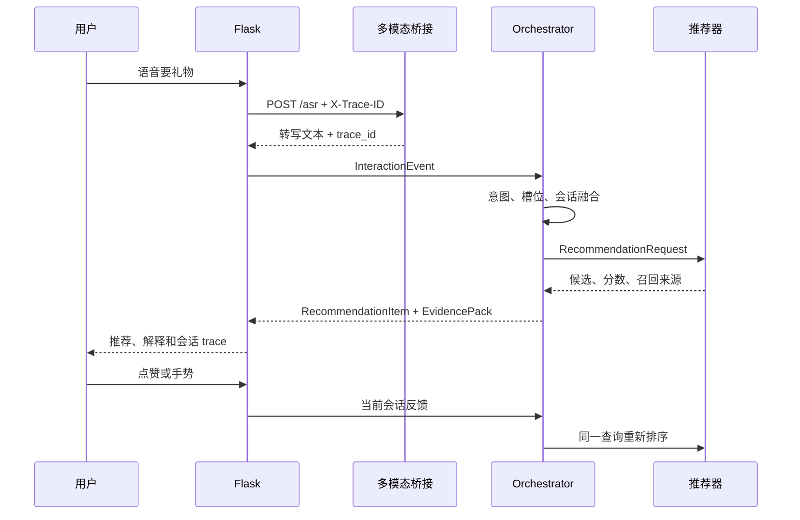

# 多模态个性化推荐助手系统架构

## 目标与边界

系统复用现有项目一的商品推荐服务和项目二的本地多模态助手，通过 HTTP 接口协作。
两个进程不读取对方内部变量，也不直接导入对方的 GUI 或模型对象。用户可以在文字、
语音或图片入口表达需求，再通过点赞、点踩、手势和继续浏览影响当前会话的排序。

脚手架不属于本项目运行依赖。在线主链路、离线规则解析和确定性验收脚本都在当前仓库内。

## 系统上下文



失败出口包括桥接不可达、模型不可用、输入格式非法、槽位缺失、约束冲突、空结果和
超时。文字规则解析与本地推荐不依赖桥接，因此多模态服务故障时仍可完成文字推荐。

## 容器与职责

| 容器 | 职责 | 输入 | 输出 |
|---|---|---|---|
| Flask 推荐服务 | 鉴权、会话、编排、召回排序、反馈、页面 | HTTP、JSON、音频、图片 | HTML、JSON、音频 |
| 多模态桥接服务 | ASR、视觉、手势、TTS、LLM | HTTP 二进制或 JSON | JSON、MP3 |
| 推荐数据与模型 | 商品画像、Item2Vec 索引、用户向量 | 本地文件 | 候选与分数 |
| 会话存储 | 用户与会话隔离、槽位、冲突、撤销 | 事件 | SessionContext |

## 主链路时序



## 统一协议

`InteractionEvent` 必含 `trace_id`、`user_id`、`session_id`、`timestamp`、`source`
和 `payload`。`source` 取 `text`、`voice`、`vision`、`gesture`、`system`。

`RecommendationRequest` 继承事件 trace 与用户身份，并携带意图、查询、TopK。
`RecommendationItem` 至少包含商品事实、分数、解释、`recall_sources` 和
`evidence`。Flask 在 API 入口生成或接收 `X-Trace-ID`，桥接服务在响应头和 JSON 中
原样返回。

错误响应统一为：

```json
{
  "error": "缺少参数 q",
  "message": "缺少参数 q",
  "error_code": "MISSING_QUERY",
  "trace_id": "..."
}
```

## 状态和数据流

1. 事件先归一化成 `InteractionEvent`，非法字段立即返回结构化错误。
2. 意图规则识别 `discover / similar / filter / compare / feedback / explain`。
3. 文本、视觉和手势槽位带来源与置信度进入 `SessionContext`；低于 0.6 的视觉标签
   不参与推荐和解释。
4. 缺必选槽位时返回追问；价格上下限矛盾或多轮品类冲突时返回澄清问题。
5. Orchestrator 把统一请求交给现有 `SmartSearch`。硬约束在打分前执行，最终结果保留
   用户向量、热度、反馈或内容来源。
6. EvidencePack 只从商品画像、命中约束、召回来源和高置信度视觉标签生成解释。
   无证据时明确返回“信息不足”，不补造属性。
7. 点踩、继续浏览与短期点赞属于当前 `session_id`；长期库只保存点赞。新会话不继承
   旧会话的负反馈。

## 主要产物

| 阶段 | 入口 | 结构化证据 |
|---|---|---|
| 1 | `scripts/01_contract_test.py` | `outputs/stage01_contract_report.json` |
| 2 | `scripts/02_context_test.py` | `outputs/stage02_context_cases.jsonl`、`stage02_context_metrics.json` |
| 3 | `scripts/03_orchestrator_demo.py` | `stage03_demo.json`、三类 trace |
| 4 | `scripts/04_explanation_test.py` | `stage04_explanation_cases.jsonl`、证据表 |
| 5 | `scripts/05_feedback_ab.py` | `stage05_feedback_ab.json`、对照表 |
| 6 | `scripts/06_e2e_acceptance.py` | `outputs/stage06_acceptance.json` |
